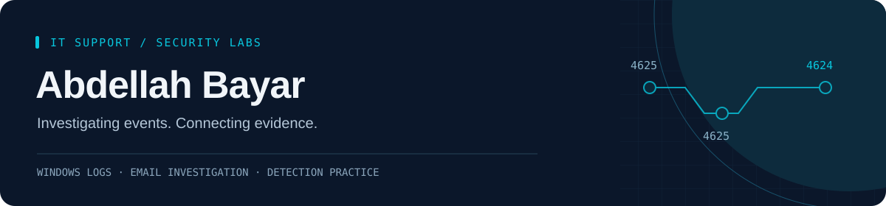

  

  <a href="https://abdellahbayar.com"><strong>Portfolio & Reports</strong></a> ·
  <a href="https://www.linkedin.com/in/abdellah-bayar/"><strong>LinkedIn</strong></a> ·
  <a href="mailto:abdellahbayar02@gmail.com"><strong>Contact</strong></a>

## About me

I'm an **IT Technician at OTS**, based in Milan, building toward a **junior SOC / cybersecurity role**.

My day-to-day work involves Microsoft environments, user access and technical troubleshooting. In my home labs, I investigate authentication events, suspicious emails and message delivery, then document the evidence, findings and steps to reproduce the work.

## Featured security labs

| Project | What I investigated or built |
| :--- | :--- |
| **[Windows Authentication Detection with Splunk](https://github.com/abdellahbayar/windows-authentication-detection-splunk)** | A five-minute failed-to-successful logon correlation rule, with 55 synthetic events, 10 test scenarios, SPL searches and dashboard configuration. |
| **[Phishing Email Investigation](https://github.com/abdellahbayar/phishing-email-investigation)** | Sender identity, authentication results, links and domain reputation, alongside a separate controlled email-delivery simulation. |
| **[Windows Authentication Lab](https://github.com/abdellahbayar/windows-authentication-lab)** | Controlled Windows logons: interpreting events 4624/4625, target accounts, logon types and failure codes. |
| **[Postfix Recipient Tracing Lab](https://github.com/abdellahbayar/postfix-recipient-tracing-lab)** | Correlating Message-ID, queue ID and Maildir delivery records to confirm five local recipients. |

The Splunk project uses synthetic data: offline reference checks passed; validation in the Splunk runtime is the next step.

## Tools & experience

- **At work:** Windows 10/11, Microsoft 365, Outlook / Exchange Online, Active Directory, Entra ID, remote support, ticket handling and VPN troubleshooting.
- **In my labs:** Windows Security logs, Event Viewer, Hyper-V, Ubuntu, Postfix, SMTP, Maildir, email headers, SPF, DKIM, DMARC and VirusTotal.
- **Detection & scripting practice:** Splunk / SPL and Python, through controlled datasets and reproducible lab exercises.

## How I approach an investigation

**Inspect → Correlate → Validate → Document**

Start with a question. Follow the relevant records. Test alternative explanations. Write down what the evidence supports and what remains unanswered.

## Next steps

Validate the authentication detections in Splunk with lab telemetry, then build a Microsoft Sentinel lab and develop KQL queries.

---

**Open to junior SOC and cybersecurity opportunities.** English and Italian CVs, lab reports and reproduction guides are available on [abdellahbayar.com](https://abdellahbayar.com/en/hire-me/).
